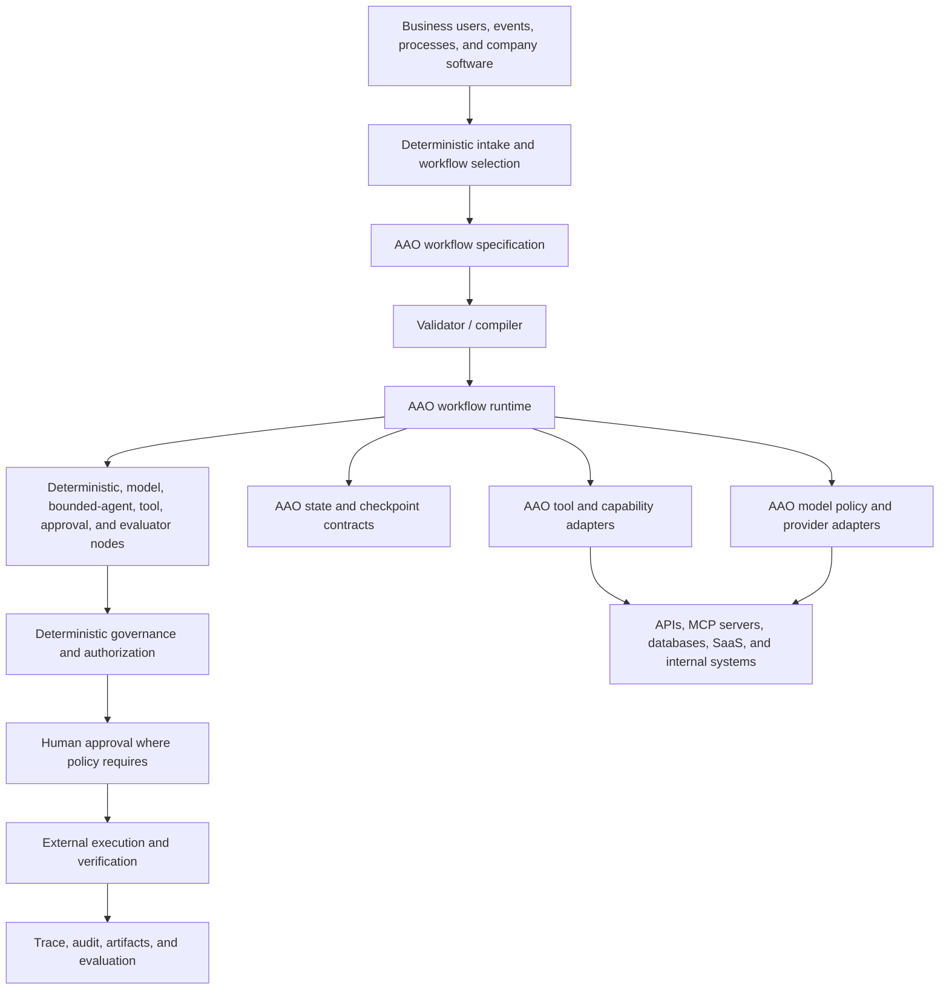

# AAO architecture

Applied AI Operations (AAO) is a reusable runtime and control layer for governed AI-powered operational workflows. AAO is a layer, not an operating system or a generic application product.

The workflow is AAO's primary execution unit. Agents are optional, bounded components that perform open-ended reasoning only where a workflow needs them. Deterministic infrastructure controls the lifecycle and every external action.



## Canonical domain contracts

`@aao/contracts` (`packages/contracts`) is the canonical, framework-neutral, vendor-neutral semantic boundary for AAO: runtime-validatable Zod schemas, with TypeScript types inferred from them, for Workflow, Node, Edge, Run, State, Checkpoint, Agent, Skill, Model Policy, Tool, Capability, Permission, Policy Decision, Approval, Eval, Trace, Artifact, Capability Pack references, and Company Configuration. The dependency direction is one-way:

```text
AAO runtime, integrations, governance, evals, packs, deployments
                              ↓
                       @aao/contracts
                              ↓
                              ✕
              external frameworks / vendors / providers
```

See [ADR-007](docs/decisions/ADR-007-canonical-domain-contracts.md) and [domain contracts](docs/architecture/domain-contracts.md) for the full contract inventory, ownership matrix, and what remains deliberately deferred (graph/runtime semantic validation, persistence, execution).

## Workflow DSL and compiler

`@aao/workflow-dsl` (`packages/workflow-dsl`) authors, parses, schema-validates, semantically validates, and compiles a Workflow before any runtime exists to execute it:

```text
Workflow Source (YAML/JSON)
      ↓
Workflow DSL (parse + canonical schema + semantic graph validation)
      ↓
Validator / Compiler
      ↓
CompiledWorkflowPlan
      ↓
Runtime V1 (@aao/runtime — see below)
```

`CompiledWorkflowPlan` is a framework-neutral, JSON-safe, deterministic artifact. See [ADR-008](docs/decisions/ADR-008-workflow-dsl-and-compiler.md) and [workflow DSL](docs/architecture/workflow-dsl.md) for the full pipeline, diagnostic codes, and what remains deliberately deferred (condition evaluation, node config validation, registry existence checks).

## Runtime V1 and Node Registry

`@aao/runtime` (`packages/runtime`) is the first production execution engine over a `CompiledWorkflowPlan`:

```text
CompiledWorkflowPlan
      ↓
Runtime V1 (preflight, sequential unconditional execution, state-patch application)
      ↓
Node Registry
      ↓
Registered Node Executor (trusted, code-registered — never authored by workflow source)
```

Runtime V1 executes only unconditional routing with explicitly registered executors; conditional workflows and unsupported node kinds (`model`, `agent`, `tool`, `approval`, `evaluator`) fail a deterministic preflight check before any node executes, rather than partially executing. See [ADR-009](docs/decisions/ADR-009-node-registry-and-runtime-v1.md) and [runtime V1](docs/architecture/runtime-v1.md) for the full pipeline, state semantics, and failure taxonomy, and what remains deliberately deferred (conditional routing, model/agent/tool/approval/evaluator execution, retries, persistence, durability, parallel execution).

## Canonical architecture documents

- [Product contract](docs/product/product-contract.md) — product purpose, boundaries, V1 proof, and success criteria.
- [Domain contracts](docs/architecture/domain-contracts.md) — the canonical `@aao/contracts` inventory and ownership matrix.
- [Workflow DSL](docs/architecture/workflow-dsl.md) — YAML/JSON authoring, parsing, semantic validation, and compilation into a `CompiledWorkflowPlan`.
- [Runtime V1](docs/architecture/runtime-v1.md) — Node Registry, runtime preflight, deterministic execution, and state/failure semantics.
- [System boundaries](docs/architecture/system-boundaries.md) — architectural layers and ownership.
- [Core vs company](docs/architecture/core-vs-company.md) — portability boundary and configuration responsibilities.
- [Execution model](docs/architecture/execution-model.md) — workflow-first design, responsibility split, and patterns.
- [Runtime lifecycle](docs/architecture/runtime-lifecycle.md) — run and node states.
- [State, memory, and durability](docs/architecture/state-memory-durability.md) — persistence and evidence boundaries.
- [Integration model](docs/architecture/integration-model.md) — capability adapters, provider boundaries, and MCP.
- [Permission model](docs/security/permission-model.md) — authority, approval, and sensitive-data rules.
- [Flagship V1 roadmap](docs/roadmap/flagship-v1.md) — the single canonical roadmap.

## Dependency ownership

Dependencies implement infrastructure; AAO defines product semantics.

| Capability | AAO owns | Current substrate stance |
| --- | --- | --- |
| Workflow semantics | Yes | LangGraph.js behind an adapter |
| Model policy and contracts | Yes | Vercel AI SDK behind an adapter |
| MCP policy and exposure | Yes | Official MCP TypeScript SDK as connector protocol |
| Durability semantics | Yes | Backing store deferred |
| Canonical integrations | Yes | Provider capability adapters |
| Visualization truth | Yes | xyflow may visualize backend truth later |
| Authorization | Yes | Implementation deferred |
| Evaluation | Yes | Implementation deferred |
| Trace model | Yes | Implementation deferred |

The repository's `packages/substrate-contracts`, `packages/substrate-spikes`, and `experiments` remain Sprint 0A research evidence. They are not production packages or final public contracts. A later sprint must explicitly promote, rewrite, migrate, delete, or archive each concept.

## Operating rules

The source-of-truth hierarchy is: executable contracts and schemas once implemented; canonical ADRs; this overview; domain-specific canonical documents; `AGENTS.md`; README summaries; then experiments and research. Architecture changes require ADR updates. Mock and live execution remain distinct.

## Anti-corruption rules

- Maintain one canonical implementation and contract per concept; do not create duplicate runtime paths without an explicit migration plan.
- Delete, migrate, or explicitly deprecate superseded code; remove or clearly mark superseded documents as historical.
- Do not conflate mock and live execution, weaken tests to make implementation pass, or let demo hardcoding leak into reusable core architecture.
- Keep framework-specific types behind adapter boundaries and prevent company-specific requirements from silently changing core semantics.
- A correct-looking final response is not evidence of reliable execution; evaluate the workflow, tool use, authorization, state, traces, and artifact where applicable.
- Do not enable side effects without authorization policy or durable side effects without an idempotency and recovery design.
- Add no infrastructure without a demonstrated requirement.

## Local-first contract

Current development is local-first: Local Control Center → Local Control Plane → Local AAO Runtime / Worker → Local persistence. External APIs, models, and MCP servers are exercised intentionally. No deployment target is selected; no serverless, Vercel, cloud-infrastructure, or hosted-dependency assumption defines the architecture.
