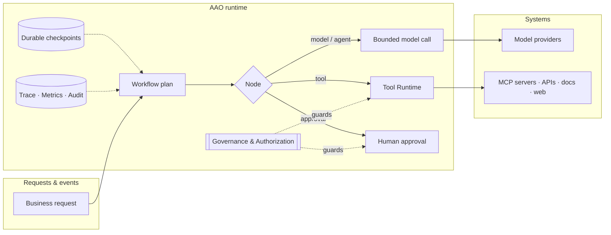

<div align="center">

# Applied AI Operations

**Governed AI workflows that a model can't talk its way out of.**

AAO is a TypeScript runtime and control layer for running AI-powered business workflows<br/>with real permissions, human approvals, durable recovery, tracing, and evaluation built in.

[](LICENSE)


[Quickstart](#quickstart) · [Why AAO](#why-aao) · [Proofs](#see-it-run) · [Architecture](ARCHITECTURE.md) · [Docs](docs/) · [Status](docs/capabilities.md)

</div>

---

## Why AAO

Most agent frameworks give the model the steering wheel and add guardrails afterwards. AAO does it the other way round.

> **The workflow comes first, and agents are optional.** Deterministic code owns validation, permissions, approvals, state transitions, and side effects.
> Models can **propose**. They can never **authorize** anything.

| | What the model does | What AAO enforces |
| --- | --- | --- |
| 🧭 **Structure** | Interprets, plans, synthesizes | Compiled workflow graph and explicit state patches |
| 🔐 **Permissions** | Asks to call a Tool | Every call is authorized against a host-attested principal. Nothing is allowed by default. |
| ✋ **Approvals** | Drafts a change | A human approval is bound to a SHA-256 fingerprint of the exact proposal, and no one can approve their own request |
| 💾 **Durability** | — | Checkpoints at safe boundaries, crash recovery, and no re-execution of completed work |
| 🔭 **Observability** | — | Privacy-minimized traces, derived metrics, and a hash-chained audit log |
| ✅ **Evaluation** | — | Versioned evals, deterministic graders, and a CI gate against an approved baseline |

## How it fits



## Quickstart

**Requirements:** Node 20.20+ and pnpm 10.

```sh
git clone https://github.com/RaulMermans/applied-ai-operations.git && cd applied-ai-operations
pnpm install --frozen-lockfile
pnpm check     # typecheck → lint → build → test → eval gate → adapter conformance
```

Define and run a governed workflow:

```ts
import { createAAO, defineGovernance, defineTool, defineWorkflow } from "@aao/framework";

const app = createAAO({
  governance: defineGovernance(config),
  principalForRun: ({ runId }) => sessionUser(runId), // identity comes from your host, never from the model
  tools: [defineTool(searchAccounts)],
});

const lookup = app.prepareWorkflow(defineWorkflow(workflow));
const result = await lookup.execute({
  runId: "run-001",
  initialState: { runId: "run-001", revision: 0, values: { request } },
});
```

Then read the [framework quickstart](docs/framework/quickstart.md) and the [`aao` CLI reference](docs/framework/cli.md).

## See it run

Each proof is a full end-to-end workflow. All of them run offline from fixtures, with **no API keys and no network**.

| Proof | What it shows | Run it |
| --- | --- | --- |
| 🔎 [Company Research](docs/proofs/company-research.md) | Model planning, governed web Tools, and citation integrity checks | `pnpm proof:company-research` |
| 📄 [Document Intelligence](docs/proofs/document-intelligence.md) | Document ingestion, evidence spans, and strict grounding validation | `pnpm proof:document-intelligence` |
| 📝 [Operational Request](docs/proofs/operational-request.md) | A model proposes a change, a human approves the exact fingerprint, and only a draft is executed | `pnpm proof:operational-request` |
| 🏢 [Company Portability](docs/proofs/company-portability.md) | Two companies run the same workflows with zero forks, fully isolated | `pnpm proof:company-portability` |
| 📦 [Capability Packs](docs/guides/use-capability-packs.md) | Versioned, reusable workflow packs adopted across companies | `pnpm proof:capability-packs` |
| 🛰️ [Operator Inspection](docs/guides/operator-control-center.md) | A read-only control center: CLI, a GET-only API, and a local page | `pnpm proof:operator-inspection` |
| 🛡️ [Security Hardening](docs/architecture/security-boundaries.md) | Trusted host identity, immutable Run binding, verified continuation, and 65 adversarial regression cases | `pnpm proof:security-hardening` |

## What's inside

<details>
<summary><b>Packages</b> (click to expand)</summary>

| Package | Role |
| --- | --- |
| `@aao/framework` | Public façade: `define*` helpers, `createAAO`, and the `aao` CLI |
| `@aao/contracts` | Canonical, runtime-validated domain contracts |
| `@aao/workflow-dsl` | YAML/JSON workflow parser, graph validator, and compiler |
| `@aao/runtime` | Node registry, managed Run lifecycle, and deterministic execution |
| `@aao/model-runtime` | Provider-neutral model calls and capability routing (Vercel AI SDK adapter) |
| `@aao/agent-runtime` | Bounded agents with at most 16 iterations and no tool use |
| `@aao/tool-runtime` | Schema-validated Tool registry and the single execution path |
| `@aao/authorization` · `@aao/governance` | Deterministic permissions from actors, roles, and deny policies |
| `@aao/approval` | Human approval waitpoints with fingerprinting and separation of duties |
| `@aao/durability` | Checkpoints, crash recovery, and replay safety |
| `@aao/observability` | Traces, metrics, and the hash-chained audit log |
| `@aao/evaluation` | Eval runtime, graders, analytics, and the CI gate |
| `@aao/adapters` | Versioned adapter contract and conformance suite |
| `@aao/mcp-connector` | MCP Tools bound as governed AAO Tools |
| `@aao/toolbox` | Curated, deterministic, provider-neutral Tools |
| `@aao/capability-packs` · `@aao/config` | Reusable workflow packs and company manifests |
| `@aao/integration-*` | Public-web and document integrations behind host-injected providers |
| `@aao/operator-inspection` | Read-only inspection layer |

</details>

```text
apps/        control-plane (Fastify) and worker
packages/    the AAO core, one package per concept
examples/    the six end-to-end proofs
evals/       versioned eval definitions, datasets, fixtures, and baselines
docs/        architecture, 30+ ADRs, guides, and proofs
```

## Honest scope

AAO is **pre-release**, and none of its packages are published to npm yet. Some things are out of scope by design:

- **No autonomous agents.** Agents reason within fixed bounds. They have no tool use, no memory, and no delegation.
- **No external side effects.** Tools that need `external_side_effect`, `destructive`, or `sensitive_data` permissions fail closed.
- **Local-first.** Durability runs on one host with one writer, and there is no deployment target or live model provider configured.

The full inventory of what exists and what deliberately doesn't is in [docs/capabilities.md](docs/capabilities.md).

## Learn more

- [ARCHITECTURE.md](ARCHITECTURE.md): the canonical architecture contract
- [Architecture decisions (ADRs)](docs/decisions/): why each boundary is where it is
- [Product contract](docs/product/product-contract.md) · [System boundaries](docs/architecture/system-boundaries.md) · [Roadmap](docs/roadmap/flagship-v1.md)
- [Local development](docs/engineering/local-development.md) · [Repository structure](docs/engineering/repository-structure.md)

## Contributing

Issues and PRs are welcome. Read [CONTRIBUTING.md](CONTRIBUTING.md) first, and report security issues as described in [SECURITY.md](SECURITY.md).

## License

[MIT](LICENSE) © 2026 Raul Mermans
